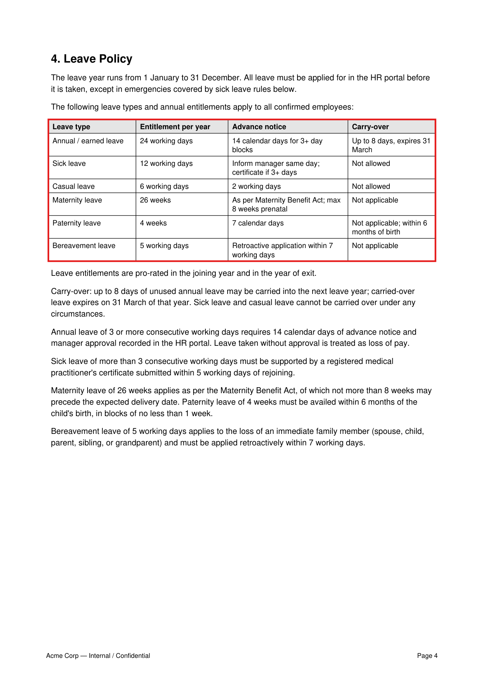

<p align="center">
  <h1 align="center">🛡️ Policy Auditor</h1>
  <p align="center"><b>Evidence-first policy Q&A over fictional sample documents, with citations checked against retrieved passages.</b></p>
</p>

<p align="center">
  
  
  
  
  
  
</p>

<p align="center">
  <a href="https://policy-auditorr.streamlit.app/">Live Demo</a>
  &nbsp;|&nbsp;
  <a href="#architecture">Architecture</a>
  &nbsp;|&nbsp;
  <a href="#evaluation-ragas">Evaluation</a>
</p>

---

## Why this exists

Ask a generic chatbot *"what's the hotel ceiling for a Grade L3 employee?"* and it will happily
invent a number. In HR/compliance the answer must come **from the document**, with a citation a
human can verify in seconds. This project is a focused portfolio demo of that workflow:

- **Grounded-answer design** — the answering model sees only reranked policy chunks and is
  prompted to cite its claims as `[document, Page N, Lines A-B]`. Generated citations are
  checked against the retrieved chunks; questions the corpus can't answer are refused.
- **Table-aware ingestion** — policy PDFs live in tables (leave quotas, travel ceilings, incident
  SLAs). PyMuPDF extracts tables as structure, and each table row gets its own line number, so a
  citation can point at the exact row.
- **Recall *and* precision** — hybrid BM25 + dense retrieval (server-side, in Milvus), LLM query
  expansion with RRF fusion across variants, then a BGE cross-encoder that re-scores the fused
  pool and keeps only the top 3 chunks.
- **Measured, not claimed** — a 16-question golden set (table lookups, cross-document
  supersession, and unanswerable traps) scored with RAGAS faithfulness + answer relevancy.

**Status:** public portfolio demo with three synthetic Acme policy documents. The reported
faithfulness score of 0.986 covers 14 judged questions out of 16; two judge calls timed out.
This small evaluation does not guarantee hallucination-free answers or demonstrate customer
adoption. Review the cited source before relying on an answer.

## Architecture

```
                ┌────────────────────────── Ingestion (offline) ─────────────────────────┐
 policy PDFs ──▶│ PyMuPDF: lines + tables + bboxes + page/line numbers                    │
                │ structure-aware chunker (headings & tables atomic, no page-crossing)    │
                │ BGE-small embeddings (384d)                                             │
                │ Milvus collection: dense HNSW + server-side BM25 sparse  ───────────────┼──▶ Milvus (Docker)
                └─────────────────────────────────────────────────────────────────────────┘        │
                                                                                                   │
                ┌────────────────────────── Query (online) ──────────────────────┐                   │
 question ─────▶│ Groq LLM: expand into 3 retrieval variants                    │                   │
                │ per-variant hybrid search (BM25 + dense, RRF in Milvus)  ◀────┼──────────────────┘
                │ cross-variant RRF fusion → candidate pool (12)                │
                │ BGE-reranker cross-encoder → top 3 chunks                     │
                │ Groq GPT-OSS-120B: grounded answer + [Page, Lines] citations │
                └───────────────────────────────────────────────────────────────┘
```

**Why both retrieval signals?** Exact tokens (`L3`, `Sev2`, `24 days`, policy names) are where
BM25 is unbeatable; paraphrases ("vacation days", "time off") are where dense embeddings win.
Milvus 2.5 runs both in one hybrid query with server-side BM25 — no hand-rolled sparse pipeline.

**Why a cross-encoder?** First-stage retrieval scores the query and the passage *separately*;
a cross-encoder reads them *jointly* (full attention across both), which is dramatically more
accurate at deciding "is this chunk actually the policy that answers this?" — at the cost of
being too slow to run over the whole corpus. Classic two-stage retrieval.

## Quickstart

**Prerequisites:** Docker Desktop, Python 3.10+, a free [Groq API key](https://console.groq.com/keys).

```bash
# 1. Infrastructure: Milvus (+etcd, +minio) via docker compose
docker compose up -d

# 2. Python environment
python -m venv .venv
.venv\Scripts\activate            # Windows   (source .venv/bin/activate on macOS/Linux)
pip install -r requirements.txt
pip install -e .

# 3. Configure
copy .env.example .env            # then paste your GROQ_API_KEY into .env

# 4. Sample corpus (3 synthetic Acme Corp policy PDFs, 21 pages, 7 tables)
python scripts/make_sample_data.py

# 5. Ingest into the hybrid index (downloads BGE models on first run)
python scripts/ingest.py

# 6. Ask away
python scripts/ask.py "What is the notice period for a Grade L3 resignation?" --verbose

# 7. UI: answer on the left, cited PDF page (highlighted) on the right
streamlit run src/policy_auditor/ui/app.py

# 8. Evaluation (RAGAS faithfulness + answer relevancy over 16 golden questions)
python scripts/evaluate.py

# 9. Retrieval A/B benchmark (chunking + reranker hit-rate over the same set)
python scripts/bench_chunking.py
```

The public Streamlit demo uses only the fictional sample policies included in this repository.
Uploads are disabled in the public UI because it does not provide per-user corpus isolation.
For local experiments, add PDFs to `data/policies/` and run the ingestion script yourself; do
not use confidential documents with the hosted demo.

Bring your own policies: drop any PDFs into `data/policies/` and re-run `python scripts/ingest.py`
(re-ingestion is idempotent per document).

## Example

```
$ python scripts/ask.py "What is the monthly internet allowance for a fully-remote Grade L1 employee as of March 2026?"

ANSWER:
From 1 March 2026, the monthly remote-work internet allowance for approved fully-remote
employees is 1,200 INR for Grades L1 and L2 [Acme_Remote_Work_Addendum_A_2026.pdf, Page 1, Lines 5-6].
This addendum supersedes the earlier 1,000 INR allowance stated in the Employee Handbook;
Grade L3 remains at 1,000 INR [Acme_Remote_Work_Addendum_A_2026.pdf, Page 1, Lines 5-7].
```

The UI renders the cited page with those exact lines highlighted, next to the answer:



## Evaluation (RAGAS)

16-question golden set over the sample corpus — table lookups, cross-section questions, a
cross-document supersession trap, and questions the corpus cannot answer (must be refused).

**Latest run** (answers: Groq GPT-OSS-120B · judge: Groq GPT-OSS-120B · local BGE embeddings):

| Metric | Score | Notes |
|---|---:|---|
| **Faithfulness** | **0.986** | every claim entailed by the retrieved chunks — no sample scored below 0.8 (judged on 14/16; 2 judge calls hit free-tier timeouts) |
| **Answer Relevancy** | **0.825** | over the 15 answerable questions (RAGAS scores refusals 0 by construction) |
| **Refusal behaviour** | **correct** | the unanswerable question was refused and redirected to related, cited policy |

Judge: GPT-OSS-120B with reasoning excluded from the visible answer. Measurement hygiene worth
knowing: citation brackets
`[doc, Page N, Lines A-B]` are stripped from answers before faithfulness scoring — otherwise
the judge decomposes them into pseudo-claims and faithfulness measures formatting, not
grounding (this single fix moved the score 0.66 → 0.99). Full per-question table:
`reports/ragas_report.md`. Run `python scripts/evaluate.py` to reproduce.

## Retrieval hit-rate benchmark

RAGAS evaluates generated answers; this separate benchmark evaluates whether retrieval found
the evidence needed to answer each question. It runs the same 16-question golden set through
four isolated Milvus collections, with query expansion and answer generation disabled so the
comparison stays focused on chunking and reranking. A question counts as a hit only when every
annotated evidence span is covered by the top-1 retrieved chunk (use `--top-k 3` for the
production answerer's top-3 view). The 15 answerable
questions are the denominator; the designed tuition-reimbursement refusal is excluded.

**Latest benchmark run:**

| Configuration | Chunks | Reranker | Full-evidence hits@1 | Hit rate@1 | Δ vs previous | Target coverage |
|---|---:|:---:|---:|---:|---:|---:|
| Fixed 512 chars | 53 | no | 11/15 | 73.3% | — | 76.5% |
| Semantic structure-aware | 32 | no | 12/15 | 80.0% | +6.7 pp | 82.3% |
| Semantic + 2-line overlap | 32 | no | 14/15 | 93.3% | +13.3 pp | 94.1% |
| Semantic + overlap + BGE reranker | 32 | yes | 14/15 | 93.3% | +0.0 pp | 94.1% |

Run `python scripts/bench_chunking.py` to regenerate the table. It writes the machine-readable
results to `reports/chunking_benchmark.json` and the full per-question matrix to
`reports/chunking_benchmark.md`. The benchmark uses citation page/line spans declared beside
each question in `evaluation/dataset.py`, making the hit definition auditable instead of relying
on a lexical similarity threshold.

## Project layout

```
src/policy_auditor/
├── ingestion/     pdf_parser.py (PyMuPDF: lines/tables/bboxes), chunker.py
├── indexing/      embedder.py (BGE), milvus_store.py (hybrid schema), pipeline.py
├── retrieval/     query_expander.py (Groq), retriever.py (RRF fusion), reranker.py (BGE)
├── generation/    prompts.py, answerer.py (grounded + citation parsing)
├── evaluation/    dataset.py (golden set), ragas_eval.py
└── ui/            app.py (Streamlit split view + highlighted source pages)
scripts/           make_sample_data.py · ingest.py · ask.py · evaluate.py · bench_chunking.py
tests/             parser / chunker / fusion / citation unit tests (pytest)
```

## Design decisions worth arguing about

- **Milvus over a plain vector DB** — BM25 runs *inside* Milvus 2.5 as a sparse-vector function,
  so hybrid search, fusion (RRF), and filtering happen server-side in one query instead of a
  client-side BM25+dense glue pipeline.
- **Chunks never cross pages, tables stay atomic** — a citation must map to one place a human can
  look at. Chunk purity beats marginal embedding quality here.
- **Citations point at line numbers, not just pages** — line-level spans come from extraction
  (each table row is one line), which is what makes the "highlight the cited region" UI possible.
- **Refusal is a feature** — the system prompt forces an explicit "insufficient information"
  answer when the top-3 chunks don't cover the question, and the golden set verifies it.
